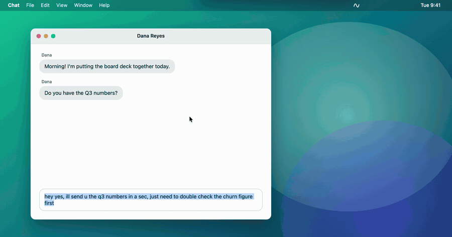
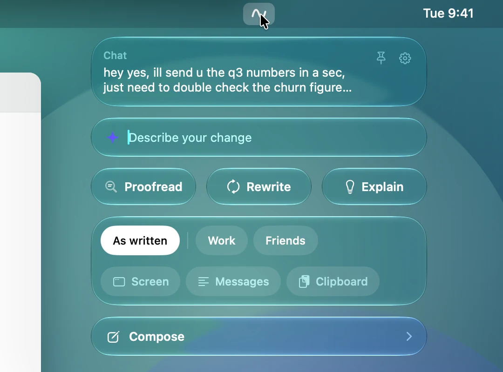
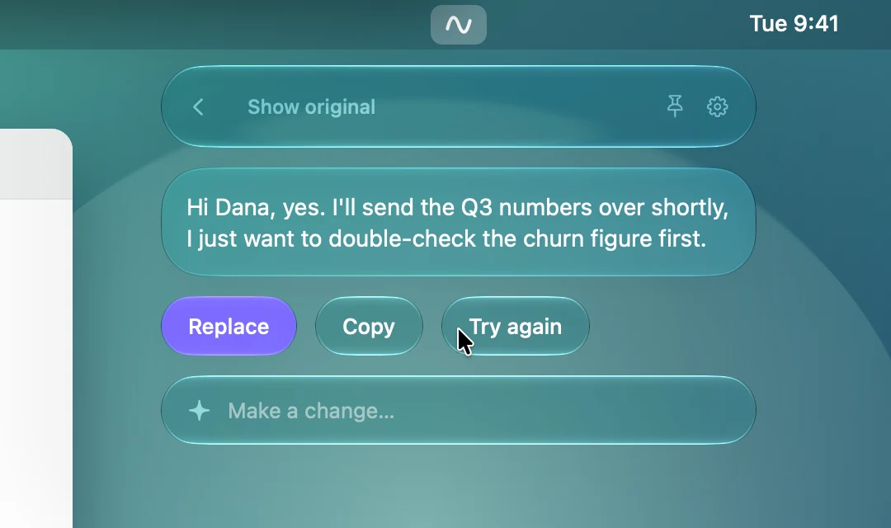
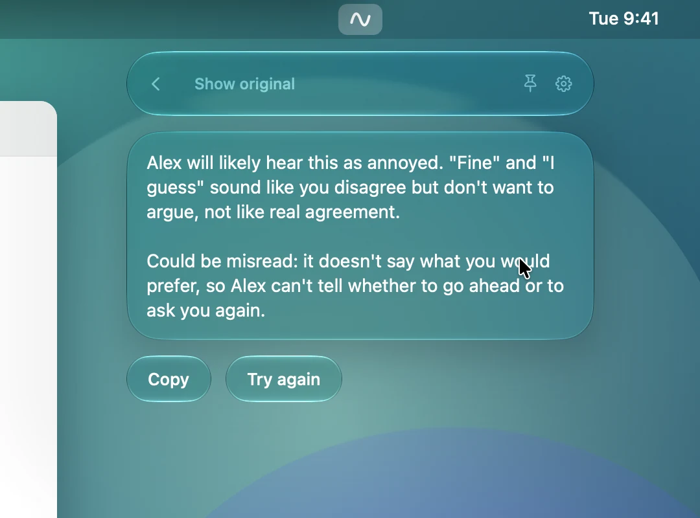
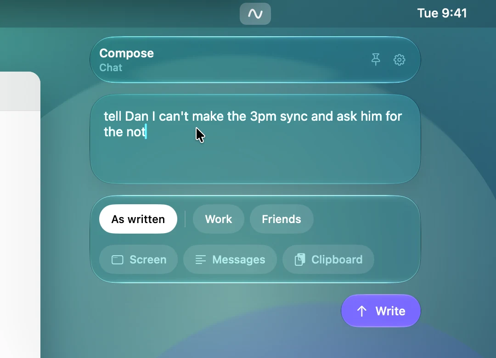
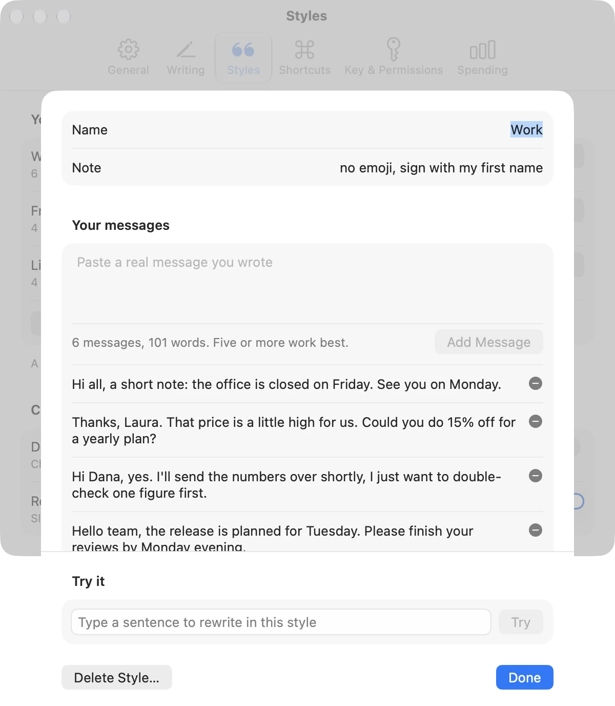
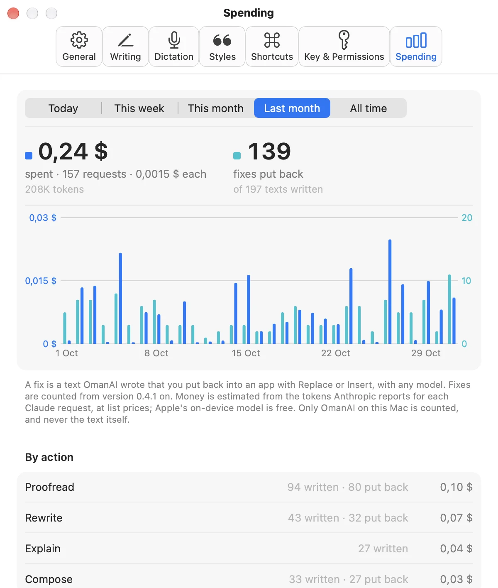
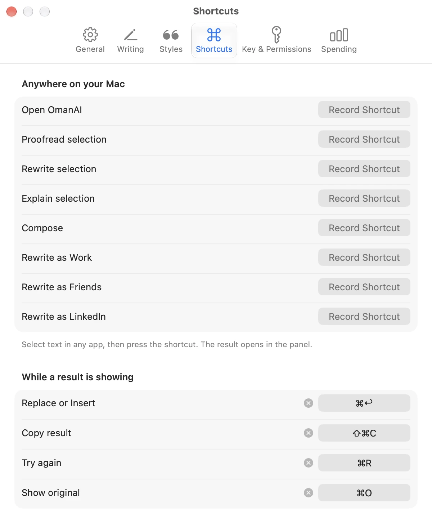
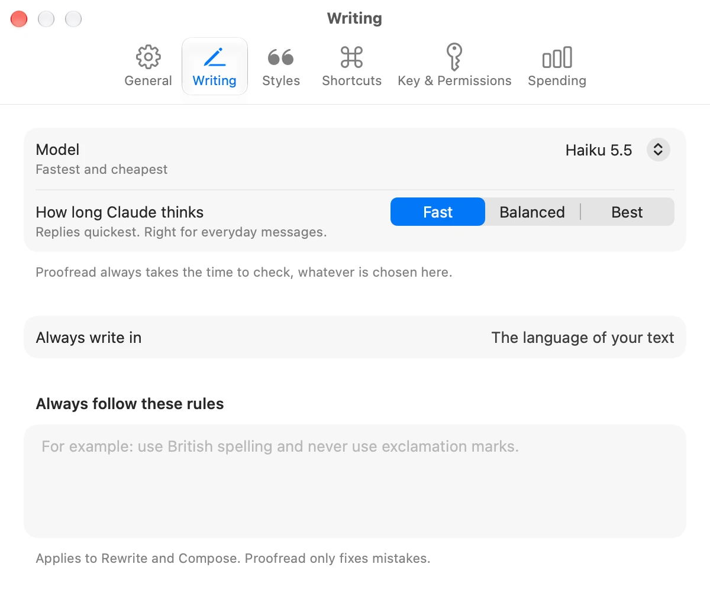
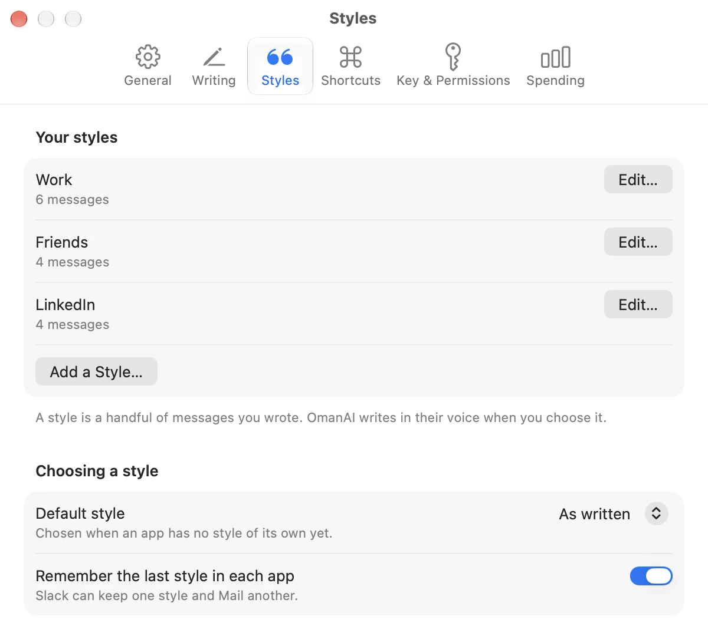

<p align="center">
  
</p>

<h1 align="center">OmanAI</h1>

<p align="center">
  <b>Your words, in your own voice.</b><br>
  A macOS menu bar app that proofreads and rewrites the text you select,<br>
  in a style built from your own messages.
</p>

<p align="center">
  <a href="https://github.com/romanbitca/oman-ai/releases/latest"></a>
  
  
  <a href="LICENSE"></a>
</p>

<p align="center">
  <a href="https://github.com/romanbitca/oman-ai/releases/latest"><b>Download</b></a> ·
  <a href="https://oman-ai.romanbitca.com">Website</a> ·
  <a href="https://oman-ai.romanbitca.com/docs/">Documentation</a> ·
  <a href="KNOWN_ISSUES.md">Known issues</a>
</p>

<p align="center">
  
</p>

Select text in any app, click the wave in your menu bar and choose what you want. The result appears in a small panel under the menu bar, and one click puts it in place of your text. Nothing ever appears in or near the field you are typing in.

OmanAI is an early release, so expect rough edges. [KNOWN_ISSUES.md](KNOWN_ISSUES.md) lists the ones we know about.

## Contents

- [What it does](#what-it-does)
- [Styles: it sounds like you](#styles-it-sounds-like-you)
- [Models](#models)
- [Install](#install)
- [Settings](#settings)
- [Privacy](#privacy)
- [Build from source](#build-from-source)

## What it does

<table>
  <tr>
    <td width="50%" valign="top">
      
      <b>One small panel.</b> Proofread, Rewrite and Explain, the style to write in, and three switches for context. It opens under the menu bar icon and closes when you are done.
    </td>
    <td width="50%" valign="top">
      
      <b>Read it before it lands.</b> The result streams into the panel. Replace puts it where your selection was, and <kbd>⌘Z</kbd> in that app brings the original back.
    </td>
  </tr>
  <tr>
    <td width="50%" valign="top">
      
      <b>Explain.</b> How will the person you are writing to understand this? What will it sound like, and what could they misread?
    </td>
    <td width="50%" valign="top">
      
      <b>Compose.</b> With nothing selected, describe the message in a line. Insert puts the text at your cursor.
    </td>
  </tr>
</table>

- **Proofread** fixes spelling and grammar and leaves your wording alone. A message you type in lower case stays in lower case, and with a style chosen that style's habits with capital letters, apostrophes and full stops decide. It marks the words it changed, and one click shows the words they replaced. Settings says whether the marks appear at once or only when you ask. With Quick fix on, its shortcut puts the corrections straight back without opening the panel, and ⌘Z brings back what you wrote.
- **Rewrite** says the same thing better, in the chosen style, or with an instruction such as "shorter" or "polite but still firm".
- **Explain** tells you how a reader will understand what you wrote. It is only for you and can never be pasted by mistake.
- **Compose** writes new text from a short request.
- **Dictation** turns what you say into text in any app, on your Mac. Hold Right ⌥ (or other Control, Option or Command keys, one or several together, or a shortcut) while you speak, or tap it for a longer dictation. Your words appear live in a small glass pill, in a card or floating on a soft blur, and are pasted at your cursor. Press ✨ instead to proofread or rewrite them in the panel first. In the panel they go straight into the field you're typing in, and Compose can copy your last transcript.
- **Context** from the window you are writing in, pasted messages or the clipboard. Only what is switched on is sent, and you see it first.
- **Shortcuts** for any action and for each of your styles, and a panel you can pin and drag anywhere.
- **Spending and fixes** by day, week, month, action, app and model: what each Claude request cost beside how many of OmanAI's texts you put back, with the details of any day on hover.
- **Your own numbers**, in OmanAI's window: the words you spoke this week, this month or in all, your streak, your speed against typing and the time it saved, where you dictate, how many corrections a proofread of yours needs week by week, and a map of your year with a square for each day. Under them are your transcripts, with search and Copy. Open OmanAI again, or right-click its menu bar icon and choose Open OmanAI.

Everything is explained button by button in the [documentation](https://oman-ai.romanbitca.com/docs/).

## Styles: it sounds like you

Most AI writing sounds like AI. A style in OmanAI is a handful of messages you really sent, and the app picks up your sentence length, your greetings and sign-offs, your punctuation and how you use emoji. It takes the voice from them and nothing else.

| You typed | Style | You get |
| --- | --- | --- |
| `hey yes, ill send u the q3 numbers in a sec, just need to double check the churn figure first` | **Work**, from six emails | Hi Dana, yes. I'll send the Q3 numbers over shortly, I just want to double-check the churn figure first. |
| | **Friends**, from a group chat | yep! sending the q3 numbers in a sec, just double checking the churn figure 👀 |
| | **As written**, your own voice | yes! sending you the Q3 numbers in a sec, just double-checking the churn figure first |

OmanAI remembers the style you last chose in each app, As written included, so Slack can keep one style and Mail another.

<p align="center">
  <picture>
    <source media="(prefers-color-scheme: dark)" srcset="site/media/settings-editor-dark.webp">
    
  </picture>
</p>

## Models

Use Claude with your own Anthropic API key, or Apple's on-device model for free.

| Model | First word | Whole answer | A message costs | Best for |
| --- | --- | --- | --- | --- |
| Claude Haiku | 0.6 s | 1.0 s | about $0.0001 | Everyday messages. Start here |
| Claude Sonnet | 0.7 s | 1.4 s | about $0.0015 | Wording that matters more |
| Claude Opus | 1.1 s | 1.8 s | about $0.004 | The few messages you really care about |
| Apple, on device | 0.8 s | 1 to 2.5 s | Free | Plain proofreading, offline and private |

These are averages over 11 short writing tasks at the Fast setting, run through the app's own client on 12 November 2026, at Anthropic's list prices. Yours will vary with the length of the text and your connection. Proofread checks the text before it writes, so with Claude Haiku a short message takes about 1.7 seconds and costs about $0.0002.

In the same tests every Claude model matched a style, followed instructions and handled Romanian. Apple's on-device model proofread plain English well, but often ignored a style when rewriting and could not handle Romanian. It takes text only and needs macOS 26 or later with Apple Intelligence turned on.

### Dictation

Every dictation model runs on your Mac and is free. Choose one, and its language, under Dictation in Settings. Live models show your words as you say them; the others read what you said again about every second, so their words follow a moment later, often more accurately.

| Model | Words show | Download | Languages | Best for |
| --- | --- | --- | --- | --- |
| Apple | As you speak | None. macOS fetches each language once | 68, one at a time | Starting at once, on macOS 26 or later |
| Parakeet Unified | As you speak | About 610 MB | English | English, fastest |
| Nemotron Unified | Within a second | About 620 MB | 25 European ones, chosen or worked out | European languages, live |
| Parakeet Ultra | A moment later | About 630 MB | 25 European ones, worked out as you speak | European languages, most accurate |
| Parakeet TDT v2 | A moment later | About 465 MB | English | English, word for word |
| Whisper Large v3 | A few seconds later | About 950 MB | About 100, chosen or worked out | The most languages, most accurate in many |
| Whisper Large v3 Turbo | A second or two later | About 630 MB | About 100, chosen or worked out | Any other language, faster |
| Parakeet Redux | A moment later | About 220 MB | 25 European ones, worked out as you speak | A small download, on macOS 15 or later |
| Whisper Small | A second or two later | About 220 MB | About 100, chosen or worked out | A small download, less accurate |

NVIDIA's Parakeet and Nemotron models, and Moondream's [Parakeet Ultra](https://huggingface.co/moondream/parakeet-ultra) and [Parakeet Redux](https://huggingface.co/moondream/parakeet-redux), run through [FluidAudio](https://github.com/FluidInference/FluidAudio). Whisper is OpenAI's large-v3, large-v3 turbo and small, run by Argmax's [WhisperKit](https://github.com/argmaxinc/argmax-oss-swift). Add your own words, such as names, under Dictation, Words, and they are written your way.

## Install

1. Download the latest `OmanAI-x.y.z.zip` from [Releases](https://github.com/romanbitca/oman-ai/releases).
2. Unzip it and move OmanAI to your Applications folder.
3. Open it, click the wave in the menu bar and follow the setup.

OmanAI needs macOS 14 or later.

It updates itself from this repository's releases: it checks once a day and installs a new version when you quit. Every update is signed, and the app checks the signature before installing. You can turn that off in Settings, under General.

## Settings

Native macOS controls, in light and dark.

<table>
  <tr>
    <td width="50%" valign="top">
      <picture>
        <source media="(prefers-color-scheme: dark)" srcset="site/media/settings-spending-dark-3.webp">
        
      </picture>
      <b>Spending</b> for today, this week, this month, last month or all time: what it cost beside the fixes you put back, split by action, app and model.
    </td>
    <td width="50%" valign="top">
      <picture>
        <source media="(prefers-color-scheme: dark)" srcset="site/media/settings-shortcuts-dark.webp">
        
      </picture>
      <b>Shortcuts</b> for every action anywhere on your Mac, and for each button on a result.
    </td>
  </tr>
  <tr>
    <td width="50%" valign="top">
      <picture>
        <source media="(prefers-color-scheme: dark)" srcset="site/media/settings-writing-dark-2.webp">
        
      </picture>
      <b>Writing</b>: the model, how long it thinks, a language and rules it always follows.
    </td>
    <td width="50%" valign="top">
      <picture>
        <source media="(prefers-color-scheme: dark)" srcset="site/media/settings-styles-dark.webp">
        
      </picture>
      <b>Styles</b>: as many as you need, a default, and a memory for each app.
    </td>
  </tr>
</table>

## Privacy

- Your styles and settings stay on your Mac in a local database, and your API key stays in the Keychain. For the Spending page, the database also keeps each Claude request's date, model, token counts and kind, and for each text OmanAI writes its kind, model, app and whether it was put back, never the text itself.
- With Claude, each request sends the selected text, the chosen style's messages and any context you switched on to Anthropic, using your own API key. There is no server of ours in between.
- With Apple's on-device model, your writing stays on your Mac.
- Dictation listens and turns speech into text on your Mac. The sound is never sent anywhere and never kept. The database keeps the text of each dictation so you can find it again in OmanAI's window; choose there how many to keep, or none, and delete them. For that window's numbers it also keeps, for each dictation, when it was, how many words, how long it took and which app it went to, never the words. These counts stay when a transcript is deleted.
- The screen is included only when you turn that on, and the panel shows the picture before it is sent.
- There are no analytics and no account. Apart from your writing requests, OmanAI only contacts GitHub to check for updates, and Hugging Face when you download a dictation model.

macOS asks for up to three permissions. Accessibility lets OmanAI read your selection and paste the result. Screen Recording is only needed if you use the Screen switch, and the Microphone only if you dictate.

## Build from source

You need Xcode 26 or later and [XcodeGen](https://github.com/yonaskolb/XcodeGen). No Apple Developer account is needed.

```bash
brew install xcodegen
cd mac
xcodegen generate
open Oman.xcodeproj
```

Run the tests with:

```bash
cd mac/OmanKit
swift test
```

Local builds are signed ad hoc and never update themselves. macOS treats each rebuild as a new app for its privacy permissions, so test Accessibility from a copy in `/Applications`.

## How the code is organised

- `mac/App` holds the menu bar item, the panel window and the updater.
- `mac/OmanKit` is a Swift package with all the logic: `OmanCore` (shared types), `ClaudeAPI` (Claude and Apple's model), `OmanStorage` (database and Keychain), `SystemBridge` (selection, paste, screen, shortcuts) and `OmanUI` (panel and Settings).
- `site` holds the website and the documentation: static HTML, CSS and JavaScript with no build step, served by nginx from `site/Dockerfile`.
- [PLAN.md](PLAN.md), [DECISIONS.md](DECISIONS.md) and [SESSION_LOG.md](SESSION_LOG.md) record the roadmap, the reasoning behind choices and the history of the work. [CLAUDE.md](CLAUDE.md) holds instructions for Claude Code.

An earlier Electron meeting recorder is kept on the [`archive/meeting-recorder`](https://github.com/romanbitca/oman-ai/tree/archive/meeting-recorder) branch.

## Contributing

Issues and pull requests are welcome. See [CONTRIBUTING.md](CONTRIBUTING.md). To report a security problem, see [SECURITY.md](SECURITY.md).

## License

[MIT](LICENSE). Bundled libraries and their licenses are listed in [ThirdPartyNotices.txt](mac/App/ThirdPartyNotices.txt).
